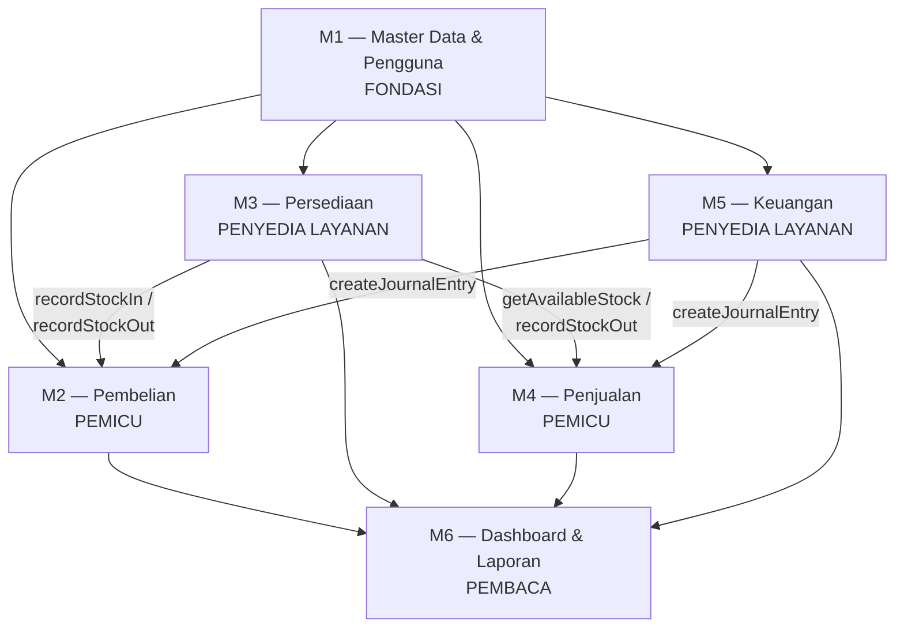
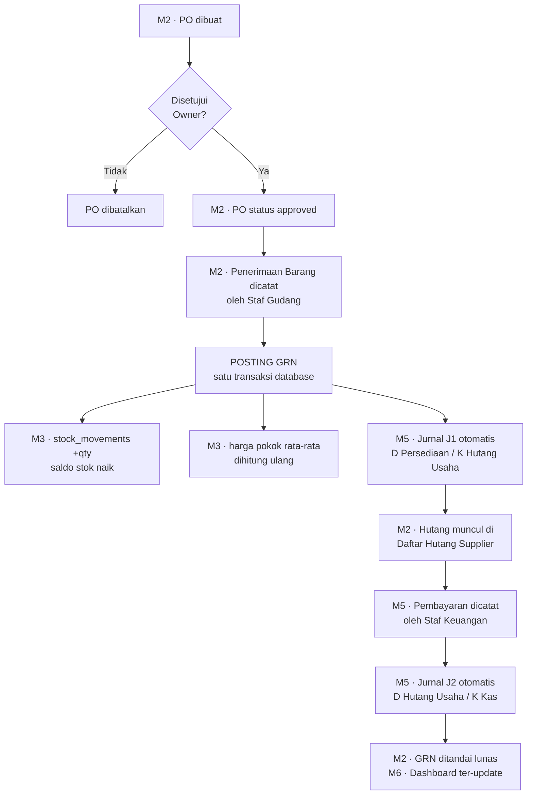
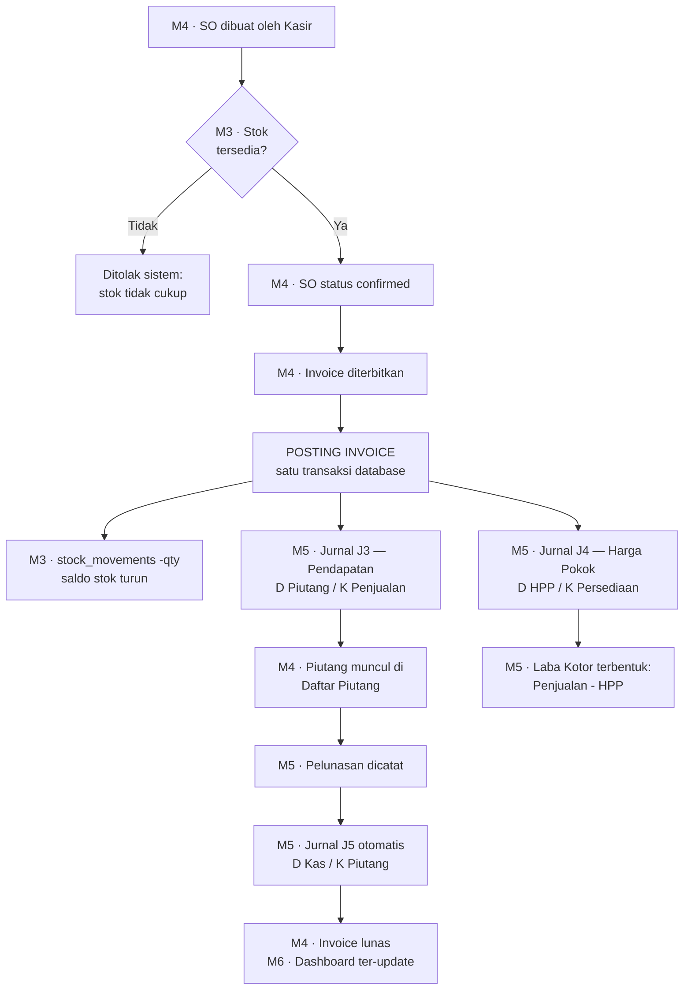
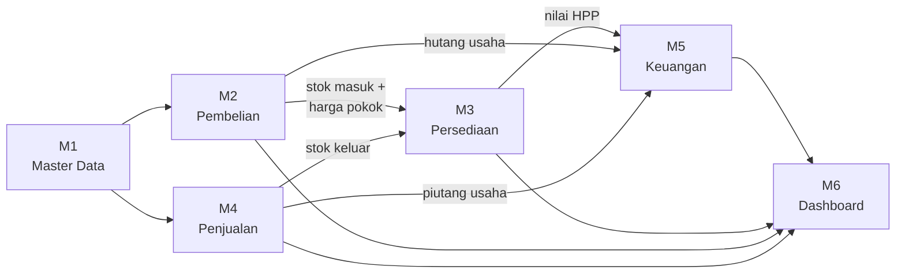
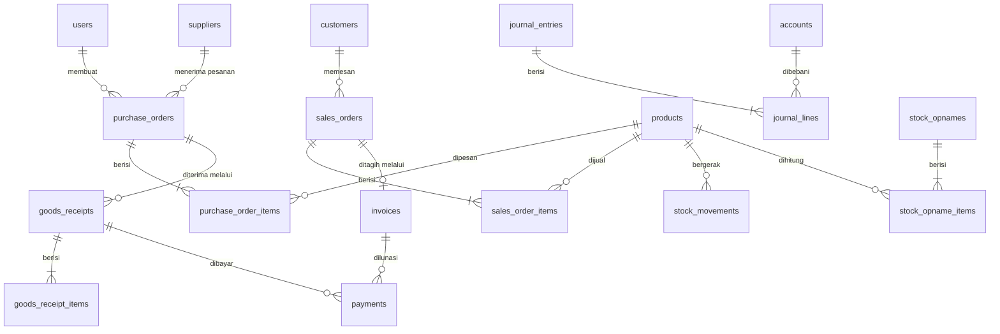
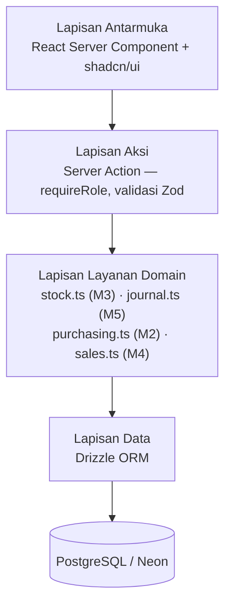
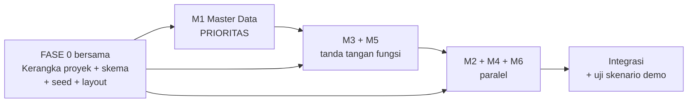

# Product Requirements Document (PRD)
## SystemERP — Sistem ERP Terintegrasi untuk UMKM Retail/Distribusi

| | |
|---|---|
| **Nama Sistem** | SystemERP |
| **Mata Kuliah** | Sistem Informasi Enterprise (Semester VII, PTIK) |
| **Bentuk Proyek** | Satu sistem, 6 modul, dikerjakan 6 kelompok |
| **Versi Dokumen** | 1.0 |
| **Tanggal** | 3 November 2026 |
| **Status** | Draft untuk ditinjau |

---

## Daftar Isi

1. [Ringkasan & Latar Belakang](#1-ringkasan--latar-belakang)
2. [Tujuan & Non-Tujuan](#2-tujuan--non-tujuan)
3. [Pembagian 6 Modul untuk 6 Kelompok](#3-pembagian-6-modul-untuk-6-kelompok)
4. [Pengguna & Peran](#4-pengguna--peran)
5. [Cakupan Fungsional per Modul](#5-cakupan-fungsional-per-modul)
6. [Alur Integrasi Inti](#6-alur-integrasi-inti)
7. [Kontrak Antarmodul](#7-kontrak-antarmodul)
8. [Model Data & Kepemilikan Tabel](#8-model-data--kepemilikan-tabel)
9. [Aturan Bisnis & Validasi](#9-aturan-bisnis--validasi)
10. [Kebutuhan Non-Fungsional](#10-kebutuhan-non-fungsional)
11. [Arsitektur & Teknologi](#11-arsitektur--teknologi)
12. [Alur Kerja Bersama & Titik Sinkronisasi](#12-alur-kerja-bersama--titik-sinkronisasi)
13. [Skenario Demo & Kriteria Penerimaan](#13-skenario-demo--kriteria-penerimaan)
14. [Risiko & Mitigasi](#14-risiko--mitigasi)
15. [Pertanyaan Terbuka](#15-pertanyaan-terbuka)
- [Lampiran A — Daftar Istilah](#lampiran-a--daftar-istilah)
- [Lampiran B — Ceklis Serah Terima per Kelompok](#lampiran-b--ceklis-serah-terima-per-kelompok)

---

## 1. Ringkasan & Latar Belakang

### 1.1 Masalah

Pada UMKM retail dan distribusi, pencatatan operasional umumnya berjalan **terpisah satu sama lain**:

- Stok barang dicatat di buku gudang atau berkas Excel tersendiri.
- Penjualan dicatat di buku kasir.
- Pembelian dan hutang ke supplier dicatat di nota yang menumpuk.
- Keuangan dihitung ulang secara manual di akhir bulan.

Akibatnya muncul tiga persoalan yang berulang:

1. **Angka stok tidak dapat dipercaya.** Catatan gudang dan kenyataan fisik berbeda karena barang keluar tidak selalu tercatat.
2. **Pemilik tidak mengetahui laba yang sebenarnya.** Omzet terlihat besar, tetapi Harga Pokok Penjualan (HPP) tidak pernah dihitung per transaksi, sehingga margin hanya berupa perkiraan.
3. **Data yang sama dicatat berulang kali.** Satu penerimaan barang harus dicatat di gudang, di buku hutang, dan di laporan keuangan — tiga kali input, tiga peluang salah.

Akar masalahnya satu: **tidak ada sumber data tunggal**. Setiap bagian memiliki versi kebenarannya sendiri.

### 1.2 Solusi yang Diusulkan

SystemERP menyatukan enam fungsi — **Master Data, Pembelian, Persediaan, Penjualan, Keuangan, dan Pelaporan** — di atas satu basis data, dengan prinsip:

> **Satu kali input, seluruh modul ter-update secara otomatis.**

Ketika staf gudang mencatat penerimaan barang, sistem secara otomatis dan dalam satu transaksi: menambah saldo stok, memperbarui harga pokok rata-rata produk, dan membentuk jurnal akuntansi hutang usaha. Tidak ada input tambahan, tidak ada rekonsiliasi manual.

### 1.3 Mengapa Ini Relevan sebagai Proyek Sistem Informasi Enterprise

Karakteristik yang membedakan sistem enterprise dari aplikasi CRUD biasa adalah **integrasi proses bisnis lintas fungsi**. Dokumen ini menempatkan integrasi tersebut sebagai inti sistem, bukan sebagai pelengkap.

Bentuk pengerjaan proyek ini — enam kelompok membangun satu sistem — justru mencerminkan kondisi nyata penerapan ERP: setiap departemen memiliki modulnya sendiri, tetapi seluruhnya wajib berbicara di atas satu basis data dengan kontrak yang jelas. Karena itu [Bagian 6 — Alur Integrasi Inti](#6-alur-integrasi-inti) dan [Bagian 7 — Kontrak Antarmodul](#7-kontrak-antarmodul) adalah dua bagian terpenting dalam dokumen ini.

---

## 2. Tujuan & Non-Tujuan

### 2.1 Tujuan Sistem

Tujuan ditulis terukur agar dapat diuji saat demo:

| No | Tujuan | Kriteria Terukur |
|----|--------|------------------|
| T1 | Menghilangkan input ganda antar modul | Satu penerimaan barang hanya diinput **satu kali**; stok dan jurnal hutang terbentuk otomatis tanpa input tambahan |
| T2 | Saldo stok selalu dapat dipertanggungjawabkan | Setiap perubahan stok memiliki baris di kartu stok yang merujuk ke dokumen sumbernya |
| T3 | Laba yang ditampilkan adalah laba sebenarnya | HPP dihitung otomatis per transaksi penjualan berdasarkan harga pokok rata-rata, bukan diisi manual |
| T4 | Pembukuan selalu seimbang | Setiap jurnal otomatis memenuhi total debit = total kredit, divalidasi sebelum disimpan |
| T5 | Akses sesuai peran | Staf gudang tidak dapat membuka modul Keuangan; kasir tidak dapat menyetujui pesanan pembelian |
| T6 | Dapat didemokan secara utuh | Satu skenario beli–jual–laporan dapat dijalankan dari awal sampai akhir (lihat Bagian 13) |

### 2.2 Tujuan Pengerjaan (Khusus Proyek 6 Kelompok)

| No | Tujuan | Kriteria Terukur |
|----|--------|------------------|
| T7 | Setiap kelompok dapat bekerja paralel tanpa saling menunggu | Setelah titik sinkronisasi pertama, tidak ada kelompok yang terblokir menunggu kelompok lain |
| T8 | Tidak ada bentrok penulisan kode | Setiap kelompok hanya menyunting berkas di dalam wilayahnya sendiri (lihat Bagian 8.1 dan 11.3) |
| T9 | Kontribusi setiap kelompok dapat ditelusuri | Setiap modul memiliki *branch* dan *pull request* sendiri di Git |

### 2.3 Non-Tujuan (Di Luar Cakupan)

Dinyatakan eksplisit agar cakupan terkunci dan tidak melebar di tengah pengerjaan:

| Tidak Termasuk | Alasan |
|----------------|--------|
| HRM / Payroll (kepegawaian, penggajian) | Tidak bersinggungan dengan alur integrasi inti; hanya menambah modul tanpa menambah nilai integrasi |
| CRM (pipeline penjualan, prospek) | Fokus sistem ada pada transaksi yang sudah terjadi, bukan calon transaksi |
| Manufaktur / BOM / Production Order | Menuntut costing berlapis; beban kerja jauh lebih besar dari sisa waktu pengerjaan |
| Multi-currency | UMKM target bertransaksi dalam Rupiah saja |
| Multi-gudang | Menambah satu dimensi pada setiap query stok tanpa menambah nilai demo |
| Retur barang (beli & jual) | Membutuhkan jurnal pembalik dan penyesuaian harga pokok; dicatat sebagai pengembangan lanjutan |
| Pembayaran cicilan / bertahap | Membutuhkan tabel alokasi pembayaran dan logika sisa hutang per dokumen |
| e-Faktur, PPN, dan pelaporan pajak | Di luar lingkup akademik mata kuliah |
| Aplikasi mobile | Antarmuka web responsif sudah mencukupi |

> Setiap butir di atas dapat ditambahkan pada iterasi berikutnya apabila diminta. Yang dihindari adalah mengerjakannya **sebelum** alur integrasi inti berfungsi.

---

## 3. Pembagian 6 Modul untuk 6 Kelompok

### 3.1 Peta Modul

| Modul | Nama Modul | Tanggung Jawab Inti | Kelompok |
|:-----:|------------|---------------------|----------|
| **M1** | **Master Data & Pengguna** | Fondasi seluruh sistem: produk, supplier, pelanggan, bagan akun, pengguna, autentikasi, otorisasi peran, penomoran dokumen, log audit | _(diisi)_ |
| **M2** | **Pembelian** | Pesanan pembelian (PO), persetujuan, penerimaan barang (GRN), daftar hutang supplier | _(diisi)_ |
| **M3** | **Persediaan** | Kartu stok, saldo stok, perhitungan harga pokok rata-rata, stock opname, peringatan stok minimum | _(diisi)_ |
| **M4** | **Penjualan** | Pesanan penjualan (SO), invoice, validasi stok tersedia, daftar piutang pelanggan | _(diisi)_ |
| **M5** | **Keuangan** | Jurnal & buku besar, pembayaran masuk/keluar, beban operasional, laporan laba rugi, neraca | _(diisi)_ |
| **M6** | **Dashboard & Laporan Manajerial** | KPI ringkas, grafik penjualan, stok kritis, transaksi terakhir, penelusuran dokumen *(drill-down)* | _(diisi)_ |

### 3.2 Hubungan Ketergantungan Antarmodul



### 3.3 Tiga Peran Modul

Keenam modul tidak memiliki sifat yang sama. Memahami perbedaan ini menentukan urutan pengerjaan:

| Peran | Modul | Sifat | Konsekuensi Jadwal |
|-------|-------|-------|--------------------|
| **Fondasi** | M1 | Dibutuhkan semua modul lain | **Harus selesai paling awal.** Selama M1 belum ada, lima kelompok lain tidak dapat menguji apa pun |
| **Penyedia layanan** | M3, M5 | Tidak dipicu pengguna secara langsung, tetapi dipanggil M2 dan M4 | **Harus menyerahkan tanda tangan fungsi (*function signature*) lebih dulu**, bahkan sebelum isinya jadi — lihat Bagian 12.2 |
| **Pemicu** | M2, M4 | Dipicu aksi pengguna, lalu memanggil M3 dan M5 | Dapat dibangun paralel setelah tanda tangan fungsi M3 dan M5 tersedia |
| **Pembaca** | M6 | Hanya membaca, tidak menulis apa pun | Dapat mulai kapan saja memakai data *seed*; tidak perlu menunggu modul lain selesai |

> **Risiko jadwal yang paling nyata pada proyek ini:** M2 dan M4 tidak dapat menyelesaikan *posting* sebelum M3 dan M5 menyediakan fungsinya. Apabila dibiarkan, dua kelompok akan menganggur menunggu dua kelompok lain. Mitigasinya ada di [Bagian 12.2 — Aturan Fungsi Tiruan](#122-aturan-fungsi-tiruan-stub-first).

### 3.4 Perbandingan Beban Kerja

Disajikan agar pembagian ke kelompok dapat dilakukan secara adil:

| Modul | Jumlah Tabel Dimiliki | Kerumitan Logika | Jumlah Halaman UI | Catatan Beban |
|:-----:|:---------------------:|------------------|:-----------------:|---------------|
| M1 | 6 | Rendah–Sedang | ~7 | Banyak CRUD, logikanya sederhana. Tetapi **paling mendesak** karena memblokir modul lain |
| M2 | 4 | Sedang | ~5 | Dua dokumen berjenjang (PO → GRN) beserta logika *posting* |
| M3 | 3 | **Tinggi** | ~4 | Rumus harga pokok rata-rata, penguncian baris, kartu stok yang dapat diaudit |
| M4 | 3 | Sedang–Tinggi | ~5 | Validasi stok, *posting* yang membentuk dua jurnal sekaligus |
| M5 | 3 | **Tinggi** | ~7 | Pembukuan berpasangan, buku besar, tiga laporan keuangan |
| M6 | 0 | Rendah–Sedang | ~3 | Tanpa tabel sendiri; beban utamanya pada query agregasi dan penyajian |

> **Saran pembagian:** M3 dan M5 sebaiknya diberikan kepada kelompok dengan kemampuan logika paling kuat, karena kedua modul inilah yang menentukan kebenaran angka seluruh sistem. M1 sebaiknya diberikan kepada kelompok yang paling siap mulai bekerja segera, bukan yang paling kuat — karena yang dibutuhkan M1 adalah kecepatan, bukan kerumitan.

---

## 4. Pengguna & Peran

### 4.1 Profil Pengguna

| Peran | Deskripsi | Kebutuhan Utama |
|-------|-----------|-----------------|
| **Owner / Manajer** | Pemilik usaha, bukan orang teknis | Ingin melihat kondisi usaha dalam satu layar: stok menipis, piutang belum tertagih, laba bulan ini |
| **Staf Gudang** | Menerima dan mengeluarkan barang fisik | Ingin mencatat barang masuk/keluar secepat mungkin, tanpa perlu paham akuntansi |
| **Kasir / Sales** | Melayani pelanggan dan membuat penjualan | Ingin membuat pesanan dan invoice dengan cepat, serta mengetahui stok tersedia saat itu |
| **Staf Keuangan** | Mengelola kas, hutang, dan piutang | Ingin mencatat pembayaran serta melihat buku besar dan laporan yang sudah terbentuk otomatis |

### 4.2 Matriks Hak Akses

Legenda: **L** = Lihat · **B** = Buat/Ubah · **S** = Setujui/Posting · **—** = Tanpa akses

| Modul | Halaman | Owner | Staf Gudang | Kasir/Sales | Staf Keuangan |
|:-----:|---------|:-----:|:-----------:|:-----------:|:-------------:|
| M6 | Dashboard | L | — | — | L |
| M1 | Master Produk | L B | L | L | L |
| M1 | Master Supplier | L B | L | — | L |
| M1 | Master Pelanggan | L B | — | L B | L |
| M1 | Bagan Akun | L | — | — | L |
| M1 | Manajemen Pengguna | L B | — | — | — |
| M2 | Pesanan Pembelian (PO) | L B **S** | L | — | L |
| M2 | Penerimaan Barang (GRN) | L | L B **S** | — | L |
| M2 | Daftar Hutang Supplier | L | — | — | L |
| M3 | Kartu Stok | L | L | L | L |
| M3 | Saldo & Nilai Persediaan | L | L | L | L |
| M3 | Stock Opname | L **S** | L B | — | — |
| M4 | Pesanan Penjualan (SO) | L B | L | L B | L |
| M4 | Invoice Penjualan | L | — | L B **S** | L |
| M4 | Daftar Piutang Pelanggan | L | — | L | L |
| M5 | Pembayaran (masuk/keluar) | L | — | — | L B **S** |
| M5 | Beban Operasional | L | — | — | L B **S** |
| M5 | Jurnal & Buku Besar | L | — | — | L |
| M5 | Laporan Keuangan | L | — | — | L |

> **Catatan desain:** pemisahan hak **B** (membuat) dan **S** (menyetujui/*posting*) adalah bentuk sederhana dari *segregation of duties* — orang yang membuat dokumen bukan orang yang mengesahkannya. Ini prinsip pengendalian internal yang membedakan sistem enterprise dari aplikasi biasa, dan menjadi salah satu butir yang diuji pada Bagian 13.

---

## 5. Cakupan Fungsional per Modul

### 5.1 M1 — Master Data & Pengguna

Fondasi seluruh transaksi. Tanpa data ini, tidak ada transaksi yang dapat dibuat.

| Fitur | Keterangan |
|-------|------------|
| CRUD Produk | SKU, nama, satuan, harga jual, stok minimum, status aktif |
| CRUD Supplier | Kode, nama, telepon, alamat, status aktif |
| CRUD Pelanggan | Kode, nama, telepon, alamat, status aktif |
| Bagan Akun | Terkunci pada 8 akun standar (lihat Bagian 9.5). Hanya dapat dilihat, tidak dapat ditambah |
| CRUD Pengguna | Nama, email, kata sandi (ter-*hash*), peran, status aktif |
| Autentikasi | Halaman masuk, sesi, keluar |
| Otorisasi Peran | Fungsi `requireRole()` yang dipakai **seluruh modul** |
| Penomoran Dokumen | Fungsi `generateDocNumber()` yang dipakai **seluruh modul** |
| Log Audit | Fungsi `logAudit()` yang dipakai **seluruh modul**, beserta halaman penampil log |
| Format Bersama | `src/lib/format.ts` — format uang dan tanggal yang dipakai **seluruh modul** (NF-20) |
| Data *Seed* | 8 akun, empat pengguna contoh, data master contoh, dan jurnal J0 setoran modal awal (Bagian 9.6) |

> **Aturan penting bagi M1:** kolom `harga_pokok_rata_rata` dan `stok_saat_ini` pada tabel `products` **tidak boleh muncul sebagai input** di form master produk. Keduanya dimiliki dan dihitung oleh M3. M1 hanya membacanya untuk ditampilkan.
>
> **Catatan tanggung jawab bersama:** `requireRole()`, `generateDocNumber()`, dan `logAudit()` dipakai lima kelompok lain. Perubahan pada ketiga fungsi ini wajib diumumkan ke seluruh kelompok — lihat Bagian 12.4.

### 5.2 M2 — Pembelian

| Fitur | Keterangan |
|-------|------------|
| Buat PO | Pilih supplier, tambah baris produk beserta qty dan harga beli, sistem menghitung total |
| Setujui PO | Status `draft` → `approved`. Hanya PO `approved` yang dapat diterima barangnya |
| Daftar PO | Dengan filter status dan supplier |
| Catat Penerimaan Barang (GRN) | Merujuk PO yang disetujui, mencatat qty yang benar-benar diterima (boleh kurang dari qty PO) |
| **Posting GRN** | Status `draft` → `posted`. **Titik pemicu integrasi** — memanggil M3 dan M5 |
| Daftar Hutang Supplier | Rekap GRN yang belum dibayar beserta totalnya |
| Batal PO | Hanya untuk PO yang belum memiliki GRN |

### 5.3 M3 — Persediaan

| Fitur | Keterangan |
|-------|------------|
| Kartu Stok per Produk | Riwayat setiap pergerakan: tanggal, jenis, qty, saldo setelah pergerakan, dokumen sumber |
| Daftar Saldo Stok | Seluruh produk beserta qty dan nilai persediaan (qty × harga pokok rata-rata) |
| Peringatan Stok Minimum | Daftar produk dengan stok di bawah batas minimum |
| Stock Opname | Catat qty fisik hasil hitung gudang, sistem menampilkan selisih terhadap qty sistem |
| Posting Stock Opname | Membentuk pergerakan `adjustment` sebesar selisih, agar saldo sistem sama dengan fisik |
| **Layanan untuk modul lain** | `recordStockIn`, `recordStockOut`, `getAvailableStock` — lihat Bagian 7.2 |

> **Prinsip desain:** tabel `stock_movements` adalah **satu-satunya sumber kebenaran** saldo stok. Kolom `stok_saat_ini` pada produk hanyalah *cache* hasil penjumlahan pergerakan, dipelihara di dalam transaksi yang sama. Kolom tersebut mempercepat tampilan daftar produk; apabila dicurigai tidak sinkron, nilainya dapat dihitung ulang dari `stock_movements` kapan saja.

### 5.4 M4 — Penjualan

| Fitur | Keterangan |
|-------|------------|
| Buat SO | Pilih pelanggan, tambah baris produk, **sistem memvalidasi stok tersedia** |
| Konfirmasi SO | Status `draft` → `confirmed` |
| Daftar SO | Dengan filter status dan pelanggan |
| Terbitkan Invoice | Membentuk invoice dari SO `confirmed`, beserta tanggal jatuh tempo |
| **Posting Invoice** | **Titik pemicu integrasi** — memanggil M3 dan M5 (dua jurnal sekaligus) |
| Daftar Piutang Pelanggan | Rekap invoice belum lunas beserta status jatuh tempo |
| Batal SO | Hanya untuk SO yang belum di-invoice |

### 5.5 M5 — Keuangan

| Fitur | Keterangan |
|-------|------------|
| Pembayaran ke Supplier | Melunasi GRN, membentuk jurnal kas keluar |
| Penerimaan dari Pelanggan | Melunasi invoice, membentuk jurnal kas masuk |
| Catat Beban Operasional | Satu-satunya titik input jurnal semi-manual (pilih beban, isi jumlah) |
| Buku Besar | Mutasi per akun beserta saldo berjalan |
| Daftar Jurnal | Seluruh jurnal beserta dokumen sumbernya, dapat ditelusuri ke transaksi asal |
| Laporan Laba Rugi | Penjualan − HPP = Laba Kotor; Laba Kotor − Beban Operasional = Laba Bersih |
| Neraca Sederhana | Aset = Liabilitas + Ekuitas + Laba Ditahan |
| **Layanan untuk modul lain** | `createJournalEntry` — lihat Bagian 7.3 |

### 5.6 M6 — Dashboard & Laporan Manajerial

| Fitur | Keterangan |
|-------|------------|
| KPI Ringkas | Nilai persediaan, total piutang, total hutang, laba bersih bulan berjalan |
| Produk Stok Kritis | Daftar produk di bawah stok minimum beserta tautan ke kartu stoknya |
| Transaksi Terakhir | 10 dokumen terakhir dari seluruh modul, dalam satu daftar gabungan |
| Grafik Penjualan | Penjualan harian 30 hari terakhir |
| Penelusuran Dokumen | Dari baris jurnal, dapat melompat ke dokumen sumbernya |

> **Aturan mutlak bagi M6:** modul ini **tidak memiliki tabel sendiri dan tidak boleh menulis apa pun** ke basis data. Seluruh isinya adalah hasil query baca terhadap tabel milik modul lain. Karena itu M6 dapat mulai bekerja paling awal dengan memanfaatkan data *seed*, tanpa menunggu modul lain selesai.

---

## 6. Alur Integrasi Inti

**Ini bagian terpenting dari dokumen ini.** Bagian 5 menjelaskan *apa* yang dilakukan setiap modul; bagian ini menjelaskan *bagaimana keenam modul saling terhubung* — yaitu alasan sistem ini disebut ERP, dan bukan enam aplikasi yang berdiri sendiri.

### 6.1 Alur Pembelian: dari Pesanan sampai Pembukuan



**Tabel aksi → efek lintas modul:**

| Aksi Pengguna | Modul Asal | Efek di M3 Persediaan | Efek di M5 Keuangan |
|---------------|:----------:|------------------------|----------------------|
| PO disetujui | M2 | — (belum ada barang fisik) | — (belum ada kewajiban) |
| **GRN di-*posting*** | M2 | Pergerakan `in` sebesar qty diterima; saldo stok naik; harga pokok rata-rata dihitung ulang | Jurnal **J1**: D Persediaan / K Hutang Usaha |
| Pembayaran ke supplier dicatat | M5 | — | Jurnal **J2**: D Hutang Usaha / K Kas & Bank |

### 6.2 Alur Penjualan: dari Pesanan sampai Laba



**Tabel aksi → efek lintas modul:**

| Aksi Pengguna | Modul Asal | Efek di M3 Persediaan | Efek di M5 Keuangan |
|---------------|:----------:|------------------------|----------------------|
| SO dibuat | M4 | Validasi: stok tersedia ≥ qty diminta (menolak bila kurang) | — |
| **Invoice di-*posting*** | M4 | Pergerakan `out` sebesar qty; saldo stok turun; mengembalikan nilai HPP | Jurnal **J3**: D Piutang / K Pendapatan<br/>Jurnal **J4**: D HPP / K Persediaan |
| Pelunasan pelanggan dicatat | M5 | — | Jurnal **J5**: D Kas & Bank / K Piutang Usaha |

> **Perhatikan Jurnal J4.** Inilah titik yang paling sering terlewat pada aplikasi penjualan sederhana. Tanpa jurnal HPP, laporan hanya menampilkan omzet, dan nilai persediaan di neraca tidak pernah berkurang — artinya laporan keuangan menjadi salah. Keberadaan J4 adalah pembeda antara aplikasi kasir dan sistem ERP.
>
> J4 juga satu-satunya tempat di seluruh sistem di mana **M3 mengembalikan nilai kepada pemanggilnya**: `recordStockOut` tidak hanya mengurangi stok, tetapi juga mengembalikan total HPP agar M4 dapat meneruskannya ke M5. Perhatikan tanda tangan fungsinya di Bagian 7.2.

### 6.3 Rangkuman Keterhubungan Keenam Modul



**Uji kelayakan cakupan:** keenam modul pada Bagian 5 muncul minimal satu kali pada diagram di atas. Tidak ada modul yang berdiri sendiri tanpa terhubung ke alur transaksi. Apabila pada pengerjaan nanti ada fitur yang tidak dapat ditempatkan pada salah satu panah di diagram ini, fitur tersebut patut dicurigai sebagai tambahan yang tidak perlu.

---

## 7. Kontrak Antarmodul

Bagian ini adalah **perjanjian teknis antar kelompok**. Setiap fungsi di bawah ini dimiliki oleh satu modul dan dipanggil oleh modul lain. Tanda tangan fungsi (nama, parameter, nilai kembali) **tidak boleh diubah secara sepihak** — perubahan wajib disepakati bersama karena akan merusak kode kelompok lain.

### 7.1 Aturan Dasar Lintas Modul

| Kode | Aturan | Alasan |
|------|--------|--------|
| **K-1** | Tabel milik modul lain **hanya boleh dibaca** (`SELECT`) | Membaca tidak merusak apa pun; menulis dapat melanggar aturan bisnis yang dijaga modul pemilik |
| **K-2** | Setiap **penulisan** ke tabel milik modul lain **wajib** melalui fungsi layanan modul pemilik | Aturan bisnis ditegakkan di satu tempat. Apabila M2 menulis langsung ke `stock_movements`, aturan harga pokok rata-rata milik M3 akan terlewat |
| **K-3** | Setiap fungsi layanan lintas modul **menerima `tx` (transaksi) sebagai parameter pertama**, dan tidak membuka transaksi sendiri | Pemanggil yang menentukan batas transaksi. Dengan begitu stok dan jurnal berada dalam satu transaksi atomik (aturan AB-12) |
| **K-4** | Fungsi layanan **melempar galat (*throw*), tidak mengembalikan `null`,** ketika aturan bisnis dilanggar | Galat yang dilempar otomatis membatalkan (*rollback*) seluruh transaksi. Nilai `null` yang terlupa diperiksa akan menghasilkan data separuh jadi |
| **K-5** | Tidak ada modul yang memanggil modul **pemicu** (M2, M4) | Arah ketergantungan harus satu arah agar tidak ada lingkaran. M2 dan M4 memanggil; keduanya tidak dipanggil |

> **K-2 adalah aturan terpenting pada proyek ini.** Satu kelompok yang mengambil jalan pintas dengan menulis langsung ke tabel milik modul lain akan membuat angka seluruh sistem salah, dan penyebabnya sangat sulit dilacak karena data terlihat masuk dengan normal. Aturan ini diperiksa pada Lampiran B.

### 7.2 Layanan yang Disediakan M3 (Persediaan)

Berkas: `src/services/stock.ts`

```ts
// Mencatat barang masuk + menghitung ulang harga pokok rata-rata.
// Dipanggil oleh: M2 (posting GRN)
async function recordStockIn(
  tx: Transaction,
  input: {
    productId: number
    qty: number            // selalu positif
    unitCost: number       // harga beli per satuan
    refType: 'goods_receipt'
    refId: number
    keterangan?: string
  }
): Promise<{ saldoSetelah: number; hargaPokokBaru: number }>

// Mencatat barang keluar + MENGEMBALIKAN nilai HPP untuk dijurnal.
// Dipanggil oleh: M4 (posting invoice)
// Melempar galat bila stok tidak cukup.
async function recordStockOut(
  tx: Transaction,
  input: {
    productId: number
    qty: number            // selalu positif
    refType: 'invoice'
    refId: number
    keterangan?: string
  }
): Promise<{ saldoSetelah: number; hppSatuan: number; hppTotal: number }>

// Pemeriksaan stok untuk umpan balik cepat di antarmuka.
// Dipanggil oleh: M4 (validasi SO), M6 (dashboard)
// CATATAN: ini BUKAN pengganti validasi di dalam recordStockOut.
async function getAvailableStock(productId: number): Promise<number>
```

**Yang menjadi tanggung jawab M3 di dalam fungsi tersebut:**
- Menulis baris `stock_movements` beserta `saldo_setelah`
- Memperbarui `products.stok_saat_ini` dan `products.harga_pokok_rata_rata`
- Mengunci baris produk (`FOR UPDATE`) sebelum mengubah saldo
- Melempar galat apabila stok akan menjadi negatif

**Yang bukan tanggung jawab M3:** membentuk jurnal. M3 hanya mengembalikan nilai HPP; yang menjurnal adalah pemanggil melalui M5.

### 7.3 Layanan yang Disediakan M5 (Keuangan)

Berkas: `src/services/journal.ts`

```ts
// Membentuk satu jurnal beserta baris-barisnya.
// Dipanggil oleh: M2 (J1), M4 (J3 & J4), M5 sendiri (J2, J5, J6)
// Melempar galat bila total debit != total kredit.
async function createJournalEntry(
  tx: Transaction,
  input: {
    tanggal: Date
    keterangan: string
    refType: 'opening_balance' | 'goods_receipt' | 'invoice' | 'invoice_hpp'
           | 'payment' | 'expense' | 'stock_opname'
    refId: number | null
    userId: number
    lines: Array<{
      accountCode: string   // contoh: '1-300' — memakai kode, bukan id, agar pemanggil tidak perlu query akun
      debit: number         // nol bila baris ini kredit
      kredit: number        // nol bila baris ini debit
      keterangan?: string
    }>
  }
): Promise<{ journalEntryId: number; nomor: string }>
```

**Yang menjadi tanggung jawab M5 di dalam fungsi tersebut:**
- Memeriksa `Σ debit === Σ kredit`, melempar galat bila tidak seimbang
- Memeriksa setiap baris hanya mengisi salah satu di antara debit atau kredit, tidak keduanya
- Menerjemahkan `accountCode` menjadi `account_id`
- Membuat nomor jurnal melalui `generateDocNumber('JV')` milik M1
- Menulis `journal_entries` beserta seluruh `journal_lines`

> **Pemeriksaan keseimbangan berada di satu fungsi ini saja.** Ketujuh templat jurnal pada Bagian 9.6 seluruhnya melewatinya. Konsekuensinya: apabila nanti ada templat jurnal kedelapan, aturan keseimbangan otomatis berlaku padanya tanpa ada kode tambahan. Tidak boleh ada jalur kode mana pun yang menyisipkan `journal_lines` tanpa melalui `createJournalEntry`.

### 7.4 Layanan yang Disediakan M1 (Master Data)

Berkas: `src/lib/auth-guard.ts`, `src/services/numbering.ts`, `src/services/audit.ts`

```ts
// Dipanggil di AWAL setiap Server Action di seluruh modul.
// Melempar galat bila sesi tidak sah atau peran tidak diizinkan.
async function requireRole(
  roles: Array<'owner' | 'gudang' | 'sales' | 'keuangan'>
): Promise<{ userId: number; nama: string; peran: string }>

// Membuat nomor dokumen berurut di dalam transaksi pemanggil.
// Format: PREFIKS/TAHUN/BULAN/0001
async function generateDocNumber(
  tx: Transaction,
  prefix: 'PO' | 'GRN' | 'SO' | 'INV' | 'PAY' | 'JV' | 'OPN'
): Promise<string>

// Mencatat jejak audit. Dipanggil setiap aksi create/update/post/cancel.
async function logAudit(
  tx: Transaction,
  input: {
    userId: number
    aksi: 'create' | 'update' | 'post' | 'cancel'
    entitas: string          // nama tabel
    entitasId: number
    detail?: Record<string, unknown>
  }
): Promise<void>
```

### 7.5 Layanan Timbal Balik: Penandaan Pelunasan

Satu kebutuhan melanggar arah ketergantungan apabila tidak ditangani: ketika M5 mencatat pembayaran, status lunas harus tercatat pada dokumen milik M2 (GRN) atau M4 (invoice). Menurut aturan K-2, M5 tidak boleh menulis langsung ke tabel tersebut.

Penyelesaiannya: **M2 dan M4 masing-masing menyediakan satu fungsi penandaan** yang dipanggil M5.

```ts
// Disediakan M2 — src/services/purchasing.ts
async function markGoodsReceiptPaid(tx: Transaction, grnId: number): Promise<void>

// Disediakan M4 — src/services/sales.ts
async function markInvoicePaid(tx: Transaction, invoiceId: number): Promise<void>
```

> Ini satu-satunya pengecualian terhadap aturan K-5, dan sengaja dibatasi pada dua fungsi yang sangat sempit: keduanya hanya mengubah satu kolom status, tidak memicu apa pun. Pembatasan ini penting agar tidak terbentuk ketergantungan melingkar yang membuat urutan pengerjaan tidak mungkin disusun.

### 7.6 Ringkasan Matriks Pemanggilan

| Modul Pemanggil ↓ \ Penyedia → | M1 | M2 | M3 | M4 | M5 |
|---|:--:|:--:|:--:|:--:|:--:|
| **M1** Master Data | — | — | — | — | — |
| **M2** Pembelian | `requireRole`, `generateDocNumber`, `logAudit` | — | `recordStockIn` | — | `createJournalEntry` |
| **M3** Persediaan | `requireRole`, `generateDocNumber`, `logAudit` | — | — | — | `createJournalEntry` *(opname)* |
| **M4** Penjualan | `requireRole`, `generateDocNumber`, `logAudit` | — | `getAvailableStock`, `recordStockOut` | — | `createJournalEntry` |
| **M5** Keuangan | `requireRole`, `generateDocNumber`, `logAudit` | `markGoodsReceiptPaid` | — | `markInvoicePaid` | — |
| **M6** Dashboard | `requireRole` | *baca tabel* | *baca tabel* | *baca tabel* | *baca tabel* |

---

## 8. Model Data & Kepemilikan Tabel

### 8.1 Kepemilikan Tabel per Modul

Kolom **Pemilik** menentukan kelompok mana yang menulis definisi tabel, migrasinya, dan satu-satunya yang boleh menulis data ke dalamnya.

| Tabel | Pemilik | Boleh Dibaca Modul | Catatan |
|-------|:-------:|--------------------|---------|
| `users` | M1 | semua | |
| `products` | M1 | semua | **Dua kolom dikecualikan** — lihat 8.2 |
| `suppliers` | M1 | M2, M6 | |
| `customers` | M1 | M4, M6 | |
| `accounts` | M1 | M5, M6 | Diisi melalui *seed*, bukan oleh pengguna |
| `audit_logs` | M1 | M1, M6 | Ditulis semua modul **melalui `logAudit()`** |
| `purchase_orders` | M2 | M6 | |
| `purchase_order_items` | M2 | M6 | |
| `goods_receipts` | M2 | M5, M6 | Kolom `status_bayar` diubah M5 **melalui `markGoodsReceiptPaid()`** |
| `goods_receipt_items` | M2 | M6 | |
| `stock_movements` | M3 | M6 | Ditulis M2 & M4 **melalui `recordStockIn/Out()`** |
| `stock_opnames` | M3 | M6 | |
| `stock_opname_items` | M3 | M6 | |
| `sales_orders` | M4 | M6 | |
| `sales_order_items` | M4 | M6 | |
| `invoices` | M4 | M5, M6 | Kolom `status_bayar` diubah M5 **melalui `markInvoicePaid()`** |
| `journal_entries` | M5 | M6 | Ditulis M2 & M4 **melalui `createJournalEntry()`** |
| `journal_lines` | M5 | M6 | |
| `payments` | M5 | M6 | |
| *(tanpa tabel)* | M6 | — | M6 hanya membaca |

### 8.2 Pengecualian Khusus: Tabel `products`

Tabel `products` dimiliki M1, tetapi dua kolomnya dimiliki M3:

| Kolom | Pemilik Penulisan | Aturan |
|-------|:-----------------:|--------|
| `sku`, `nama`, `satuan`, `harga_jual`, `stok_minimum`, `aktif` | **M1** | Diinput melalui form master produk |
| `stok_saat_ini` | **M3** | Hanya diubah di dalam `recordStockIn/Out`. M1 tidak menampilkannya sebagai input |
| `harga_pokok_rata_rata` | **M3** | Hanya diubah di dalam `recordStockIn`. M1 tidak menampilkannya sebagai input |

> Pembagian pada satu tabel seperti ini perlu ditulis eksplisit karena merupakan sumber kesalahan yang paling mudah terjadi: form master produk yang kelebihan satu kolom input akan membuat seseorang dapat mengubah stok tanpa jejak di kartu stok, dan seluruh angka persediaan menjadi tidak dapat dipertanggungjawabkan.

### 8.3 Diagram Relasi Entitas



### 8.4 Daftar Entitas

#### Milik M1 — Master Data

**`users`**
| Kolom | Tipe | Keterangan |
|-------|------|------------|
| `id` | serial PK | |
| `nama` | text | |
| `email` | text unik | Digunakan untuk masuk |
| `password_hash` | text | Hasil *hash*, tidak pernah disimpan sebagai teks biasa |
| `peran` | enum | `owner` \| `gudang` \| `sales` \| `keuangan` |
| `aktif` | boolean | |
| `created_at` | timestamp | |

**`products`**
| Kolom | Tipe | Pemilik | Keterangan |
|-------|------|:-------:|------------|
| `id` | serial PK | M1 | |
| `sku` | text unik | M1 | Kode produk |
| `nama` | text | M1 | |
| `satuan` | text | M1 | pcs, box, kg, dan sebagainya |
| `harga_jual` | numeric(14,2) | M1 | Diinput pengguna |
| `harga_pokok_rata_rata` | numeric(14,2) | **M3** | Dihitung sistem — lihat 9.4 |
| `stok_saat_ini` | numeric(14,2) | **M3** | *Cache* dari `stock_movements` |
| `stok_minimum` | numeric(14,2) | M1 | Batas peringatan |
| `aktif` | boolean | M1 | |

**`suppliers`** / **`customers`** — struktur serupa: `id`, `kode` (unik), `nama`, `telepon`, `alamat`, `aktif`

**`accounts`** — diisi melalui *seed*
| Kolom | Tipe | Keterangan |
|-------|------|------------|
| `id` | serial PK | |
| `kode` | text unik | Misal `1-300` |
| `nama` | text | Misal `Persediaan Barang` |
| `tipe` | enum | `aset` \| `liabilitas` \| `ekuitas` \| `pendapatan` \| `beban` |
| `saldo_normal` | enum | `debit` \| `kredit` |

**`audit_logs`**: `id`, `user_id` FK, `aksi` (`create`\|`update`\|`post`\|`cancel`), `entitas`, `entitas_id`, `waktu`, `detail` (jsonb)

#### Milik M2 — Pembelian

**`purchase_orders`**
| Kolom | Tipe | Keterangan |
|-------|------|------------|
| `id` | serial PK | |
| `nomor` | text unik | Format: `PO/2026/11/0001` |
| `supplier_id` | FK → suppliers | |
| `tanggal` | date | |
| `status` | enum | `draft` \| `approved` \| `received` \| `cancelled` |
| `total` | numeric(14,2) | |
| `dibuat_oleh` | FK → users | |
| `disetujui_oleh` | FK → users *nullable* | |

**`purchase_order_items`**: `id`, `po_id` FK, `product_id` FK, `qty`, `harga_satuan`, `subtotal`

**`goods_receipts`**
| Kolom | Tipe | Keterangan |
|-------|------|------------|
| `id` | serial PK | |
| `nomor` | text unik | Format: `GRN/2026/11/0001` |
| `po_id` | FK → purchase_orders | |
| `tanggal` | date | |
| `status` | enum | `draft` \| `posted` |
| `total` | numeric(14,2) | |
| `journal_entry_id` | FK *nullable* | Terisi saat di-*posting* — **jembatan ke M5** |
| `status_bayar` | enum | `belum` \| `lunas` — diubah M5 melalui `markGoodsReceiptPaid()` |
| `diterima_oleh` | FK → users | |

**`goods_receipt_items`**: `id`, `grn_id` FK, `product_id` FK, `qty_diterima`, `harga_satuan`, `subtotal`

#### Milik M3 — Persediaan

**`stock_movements`** — **kartu stok, sumber kebenaran tunggal saldo stok**
| Kolom | Tipe | Keterangan |
|-------|------|------------|
| `id` | serial PK | |
| `product_id` | FK → products *(diindeks)* | |
| `tanggal` | timestamp | |
| `tipe` | enum | `in` \| `out` \| `adjustment` |
| `qty` | numeric(14,2) | Bertanda: positif masuk, negatif keluar |
| `harga_satuan` | numeric(14,2) | Harga beli untuk `in`, harga pokok rata-rata untuk `out` |
| `saldo_setelah` | numeric(14,2) | Saldo stok setelah pergerakan ini — agar kartu stok dapat diaudit |
| `ref_type` | enum | `goods_receipt` \| `invoice` \| `stock_opname` |
| `ref_id` | integer | Menunjuk dokumen sumber |
| `keterangan` | text | |

**`stock_opnames`**: `id`, `nomor`, `tanggal`, `status` (`draft`\|`posted`), `dicatat_oleh` FK
**`stock_opname_items`**: `id`, `opname_id` FK, `product_id` FK, `qty_sistem`, `qty_fisik`, `selisih`

#### Milik M4 — Penjualan

**`sales_orders`**
| Kolom | Tipe | Keterangan |
|-------|------|------------|
| `id` | serial PK | |
| `nomor` | text unik | Format: `SO/2026/11/0001` |
| `customer_id` | FK → customers | |
| `tanggal` | date | |
| `status` | enum | `draft` \| `confirmed` \| `invoiced` \| `cancelled` |
| `total` | numeric(14,2) | |
| `dibuat_oleh` | FK → users | |

**`sales_order_items`**: `id`, `so_id` FK, `product_id` FK, `qty`, `harga_satuan`, `subtotal`

**`invoices`**
| Kolom | Tipe | Keterangan |
|-------|------|------------|
| `id` | serial PK | |
| `nomor` | text unik | Format: `INV/2026/11/0001` |
| `so_id` | FK → sales_orders | |
| `tanggal` | date | |
| `jatuh_tempo` | date | |
| `total` | numeric(14,2) | Nilai jual |
| `total_hpp` | numeric(14,2) | Dihitung saat *posting*, dari nilai kembali `recordStockOut` |
| `status` | enum | `draft` \| `posted` \| `cancelled` |
| `status_bayar` | enum | `belum` \| `lunas` — diubah M5 melalui `markInvoicePaid()` |
| `journal_entry_id` | FK *nullable* | Jurnal J3 — pendapatan |
| `journal_entry_hpp_id` | FK *nullable* | Jurnal J4 — harga pokok |

#### Milik M5 — Keuangan

**`journal_entries`**
| Kolom | Tipe | Keterangan |
|-------|------|------------|
| `id` | serial PK | |
| `nomor` | text unik | Format: `JV/2026/11/0001` |
| `tanggal` | date | |
| `keterangan` | text | |
| `ref_type` | enum | `opening_balance` \| `goods_receipt` \| `invoice` \| `invoice_hpp` \| `payment` \| `expense` \| `stock_opname` |
| `ref_id` | integer *nullable* | **Memungkinkan penelusuran dari laporan ke dokumen sumber** |
| `total_debit` | numeric(14,2) | |
| `total_kredit` | numeric(14,2) | Wajib sama dengan `total_debit` |
| `dibuat_oleh` | FK → users | |

**`journal_lines`**
| Kolom | Tipe | Keterangan |
|-------|------|------------|
| `id` | serial PK | |
| `journal_entry_id` | FK *(diindeks)* | |
| `account_id` | FK → accounts | |
| `debit` | numeric(14,2) | Nol bila baris ini kredit |
| `kredit` | numeric(14,2) | Nol bila baris ini debit |
| `keterangan` | text | |

**`payments`**
| Kolom | Tipe | Keterangan |
|-------|------|------------|
| `id` | serial PK | |
| `nomor` | text unik | Format: `PAY/2026/11/0001` |
| `tipe` | enum | `in` (dari pelanggan) \| `out` (ke supplier) |
| `ref_type` | enum | `invoice` \| `goods_receipt` |
| `ref_id` | integer | Dokumen yang dilunasi |
| `tanggal` | date | |
| `jumlah` | numeric(14,2) | |
| `metode` | enum | `kas` \| `transfer` |
| `journal_entry_id` | FK | |
| `dicatat_oleh` | FK → users | |

### 8.5 Catatan Desain Model Data

1. **`numeric`, bukan `float`, untuk semua nilai uang dan qty.** Bilangan pecahan biner tidak dapat merepresentasikan nilai desimal secara tepat; `0.1 + 0.2` tidak sama dengan `0.3`. Pada data keuangan, galat semacam ini membuat jurnal tidak seimbang dan sangat sulit dilacak penyebabnya. **Berlaku wajib bagi keenam kelompok.**
2. **Kolom `journal_entry_id` pada dokumen transaksi adalah jembatan antar modul.** Keberadaan kolom ini membuktikan dokumen operasional dan catatan akuntansi benar-benar terhubung di tingkat basis data, bukan hanya di tingkat antarmuka.
3. **`ref_type` + `ref_id` dipakai sebagai relasi polimorfik** pada `stock_movements`, `journal_entries`, dan `payments`. Penelusuran dilakukan di lapisan aplikasi, bukan melalui *foreign key* basis data. Pilihan ini diambil secara sadar: alternatifnya adalah menambah satu kolom FK *nullable* per jenis dokumen, yang membuat tabel melebar setiap kali ada jenis dokumen baru — dan setiap penambahan menyentuh tabel milik modul lain, yang justru ingin dihindari pada proyek enam kelompok.
4. **Tidak ada penghapusan data transaksi.** Dokumen yang salah dibatalkan melalui status `cancelled` beserta jurnal pembalik, bukan dihapus. Riwayat harus tetap utuh agar dapat diaudit.

---

## 9. Aturan Bisnis & Validasi

### 9.1 Aturan Dokumen

| Kode | Aturan | Pemilik | Alasan |
|------|--------|:-------:|--------|
| AB-1 | Dokumen berstatus `posted` **tidak dapat diubah** | M2, M4 | Jurnal sudah terbentuk; mengubah dokumen membuat pembukuan tidak sesuai dokumen sumbernya |
| AB-2 | Pembatalan dokumen `posted` melalui **jurnal pembalik**, bukan penghapusan | M5 | Menjaga jejak audit tetap utuh |
| AB-3 | GRN hanya dapat dibuat untuk PO berstatus `approved` | M2 | Mencegah barang masuk tanpa pesanan yang sah |
| AB-4 | Qty diterima tidak boleh melebihi qty pada PO | M2 | Mencegah penerimaan di luar kesepakatan |
| AB-5 | Invoice hanya dapat dibuat dari SO berstatus `confirmed` | M4 | Mencegah penagihan atas pesanan yang belum pasti |
| AB-6 | PO/SO yang sudah memiliki dokumen turunan tidak dapat dibatalkan | M2, M4 | Mencegah dokumen turunan menggantung tanpa induk |

### 9.2 Aturan Persediaan

| Kode | Aturan | Pemilik | Penerapan |
|------|--------|:-------:|-----------|
| AB-7 | **Stok tidak boleh negatif** | M3 + M4 | Divalidasi dua kali: saat pembuatan SO oleh M4 (umpan balik cepat), dan sekali lagi di dalam `recordStockOut` milik M3 dengan penguncian baris produk (`SELECT ... FOR UPDATE`) |
| AB-8 | Setiap perubahan stok wajib memiliki baris `stock_movements` | M3 | Tidak ada jalur kode yang mengubah `stok_saat_ini` tanpa menulis pergerakan |
| AB-9 | `saldo_setelah` dihitung di dalam transaksi yang sama | M3 | Kartu stok dapat diperiksa baris per baris tanpa menjumlahkan ulang |

> **Catatan mengenai AB-7 — penting bagi M3 dan M4.** Validasi pada pembuatan SO saja tidak cukup. Di antara saat SO dibuat dan saat invoice di-*posting*, stok dapat sudah diambil transaksi lain. Oleh karena itu validasi penentu berada di dalam `recordStockOut` dengan penguncian baris. Validasi M4 hanya untuk kenyamanan pengguna; validasi M3 yang menjaga kebenaran data. **M4 tidak boleh menganggap validasinya sendiri cukup, dan M3 tidak boleh menganggap M4 sudah memvalidasi.**

### 9.3 Aturan Akuntansi

| Kode | Aturan | Pemilik | Penerapan |
|------|--------|:-------:|-----------|
| AB-10 | **Setiap jurnal wajib seimbang**: total debit = total kredit | M5 | Diperiksa di dalam `createJournalEntry` sebelum `commit`; bila tidak seimbang, galat dilempar dan seluruh transaksi dibatalkan |
| AB-11 | Jurnal dibentuk dari **templat per jenis transaksi**, bukan diinput bebas | M2, M4, M5 | Mengunci kebenaran pembukuan di dalam kode, bukan bergantung pada ketelitian pengguna |
| AB-12 | Satu *posting* dokumen = satu transaksi basis data atomik | M2, M4 | Tidak boleh terjadi stok sudah naik tetapi jurnal gagal terbentuk |
| AB-13 | Jurnal tidak dapat dihapus | M5 | Hanya dibalik dengan jurnal pembalik |

### 9.4 Perhitungan Harga Pokok Rata-Rata — *Milik M3*

Metode: **rata-rata bergerak** (*moving weighted average*).

Saat barang masuk:

```
harga_pokok_baru = ((stok_lama x harga_pokok_lama) + (qty_masuk x harga_beli))
                   / (stok_lama + qty_masuk)
```

Saat barang keluar: harga pokok **tidak berubah**; nilai HPP yang dikembalikan adalah `qty_keluar x harga_pokok_rata_rata` saat itu.

Contoh — **angka ini wajib dipakai M3 sebagai pemeriksaan mandiri:**

| Kejadian | Qty | Harga | Stok | Harga Pokok Rata-Rata | Perhitungan |
|----------|----:|------:|-----:|----------------------:|-------------|
| Beli | +10 | 50.000 | 10 | 50.000 | (0 + 500.000) / 10 |
| Beli | +10 | 60.000 | 20 | 55.000 | (500.000 + 600.000) / 20 |
| Jual | −5 | — | 15 | 55.000 | tidak berubah; HPP dikembalikan 275.000 |

> **Penyederhanaan yang diambil secara sadar.** Metode FIFO mengharuskan sistem melacak setiap *lot* pembelian beserta sisanya, lalu mengonsumsinya berlapis saat penjualan — menambah satu tabel dan logika konsumsi yang jauh lebih rumit, untuk hasil yang secara konseptual sama-sama benar.
>
> **Jalur peningkatan ke FIFO** apabila nanti diperlukan: tambahkan tabel `stock_lots` (`product_id`, `qty_masuk`, `qty_sisa`, `harga_beli`, `tanggal`), lalu ubah **hanya** isi `recordStockIn` dan `recordStockOut`. Tanda tangan fungsi, struktur `stock_movements`, dan seluruh logika jurnal tidak perlu berubah — artinya kelima kelompok lain tidak terdampak sama sekali. Inilah manfaat nyata dari memusatkan logika HPP di balik satu kontrak fungsi.

### 9.5 Bagan Akun (Terkunci) — *Milik M1, dipakai M5*

| Kode | Nama Akun | Tipe | Saldo Normal |
|------|-----------|------|--------------|
| 1-100 | Kas & Bank | Aset | Debit |
| 1-200 | Piutang Usaha | Aset | Debit |
| 1-300 | Persediaan Barang | Aset | Debit |
| 2-100 | Hutang Usaha | Liabilitas | Kredit |
| 3-100 | Modal Pemilik | Ekuitas | Kredit |
| 4-100 | Pendapatan Penjualan | Pendapatan | Kredit |
| 5-100 | Harga Pokok Penjualan | Beban | Debit |
| 5-200 | Beban Operasional | Beban | Debit |

> **Penyederhanaan yang diambil secara sadar.** Bagan akun dikunci pada 8 akun dan tidak dapat ditambah oleh pengguna. Yang dinilai pada sistem ini adalah **jurnal otomatis yang terbentuk dari transaksi operasional**, bukan keleluasaan mengelola master akun. Membuka pembuatan akun bebas justru menimbulkan risiko pengguna memilih akun yang salah dan merusak laporan.

### 9.6 Templat Jurnal Otomatis

Seluruh jurnal pada sistem terbentuk dari tujuh templat berikut. Setiap templat sudah diperiksa seimbang. Kolom **Pembuat** menunjukkan modul yang memanggil `createJournalEntry`.

| No | Pemicu | Pembuat | Debit | Kredit | Nilai |
|----|--------|:-------:|-------|--------|-------|
| **J0** | Setoran modal awal *(data seed, sekali saja)* | M1 | 1-100 Kas & Bank | 3-100 Modal Pemilik | Jumlah setoran |
| **J1** | GRN di-*posting* | M2 | 1-300 Persediaan | 2-100 Hutang Usaha | Σ(qty diterima × harga beli) |
| **J2** | Pembayaran ke supplier | M5 | 2-100 Hutang Usaha | 1-100 Kas & Bank | Jumlah dibayar |
| **J3** | Invoice di-*posting* (pendapatan) | M4 | 1-200 Piutang Usaha | 4-100 Pendapatan Penjualan | Σ(qty × harga jual) |
| **J4** | Invoice di-*posting* (harga pokok) | M4 | 5-100 HPP | 1-300 Persediaan | Σ `hppTotal` dari `recordStockOut` |
| **J5** | Pelunasan dari pelanggan | M5 | 1-100 Kas & Bank | 1-200 Piutang Usaha | Jumlah diterima |
| **J6** | Beban operasional dicatat | M5 | 5-200 Beban Operasional | 1-100 Kas & Bank | Jumlah beban |

> **J3 dan J4 selalu terbentuk berpasangan** dalam satu transaksi *posting* invoice oleh M4. Apabila salah satu gagal, keduanya dibatalkan beserta pengurangan stoknya.
>
> **J0 bukan fitur, melainkan data awal.** Tanpa setoran modal, saldo kas pada skenario demo menjadi minus — pembayaran ke supplier (Rp 500.000) lebih besar dari penerimaan dari pelanggan (Rp 320.000). Secara akuntansi tetap benar dan neraca tetap seimbang, tetapi kas minus akan menjadi pertanyaan pertama penilai dan mengalihkan perhatian dari hal yang ingin ditunjukkan. J0 juga memberi fungsi kepada akun `3-100 Modal Pemilik`, yang tanpanya tidak pernah terpakai di seluruh sistem.
>
> J0 ditulis di `seed.ts` oleh M1 **melalui `createJournalEntry`**, bukan dengan menyisipkan `journal_lines` langsung — aturan K-2 berlaku juga pada data *seed*. Tidak ada halaman antarmuka untuk setoran modal; menambahkannya berarti menambah fitur yang hanya dipakai sekali.

### 9.7 Penomoran Dokumen — *Milik M1*

Format: `{PREFIKS}/{TAHUN}/{BULAN}/{URUT 4 DIGIT}` — contoh `GRN/2026/11/0007`.

| Prefiks | Dokumen | Pemakai |
|---------|---------|:-------:|
| `PO` | Pesanan Pembelian | M2 |
| `GRN` | Penerimaan Barang | M2 |
| `SO` | Pesanan Penjualan | M4 |
| `INV` | Invoice Penjualan | M4 |
| `PAY` | Pembayaran | M5 |
| `JV` | Jurnal | M5 |
| `OPN` | Stock Opname | M3 |

Nomor urut di-*reset* setiap bulan dan dihasilkan **di dalam transaksi yang sama** dengan pembuatan dokumen, agar tidak ada dua dokumen bernomor sama saat beberapa pengguna bekerja bersamaan.

---

## 10. Kebutuhan Non-Fungsional

Seluruh butir di bawah ini **berlaku bagi keenam kelompok**, bukan hanya salah satunya.

### 10.1 Keamanan

| Kode | Kebutuhan | Penanggung Jawab |
|------|-----------|------------------|
| NF-1 | Kata sandi disimpan sebagai *hash* (bcrypt/argon2), tidak pernah sebagai teks biasa | M1 |
| NF-2 | Seluruh halaman dan aksi — kecuali halaman masuk — mewajibkan sesi yang sah | M1 (fungsi), semua (pemakaian) |
| NF-3 | Pemeriksaan peran dilakukan **di sisi server** pada setiap aksi, bukan hanya menyembunyikan tombol di antarmuka | semua |
| NF-4 | Seluruh masukan pengguna divalidasi dengan skema **Zod di sisi server**, sebagai batas kepercayaan sistem. Validasi di sisi klien hanya untuk kenyamanan, bukan pengamanan | semua |
| NF-5 | Seluruh akses basis data melalui *query* berparameter via Drizzle ORM — tidak ada penyusunan SQL dengan penggabungan teks | semua |
| NF-6 | Tidak ada kredensial tertulis di dalam kode; seluruhnya melalui *environment variable* | semua |
| NF-7 | Pesan galat yang ditampilkan ke pengguna tidak membocorkan *stack trace*, nama tabel, atau detail internal | semua |

> **NF-3 perlu ditegaskan pada proyek enam kelompok.** Menyembunyikan tombol di antarmuka bukan pengamanan — pengguna dapat mengakses URL secara langsung. Setiap *Server Action* di modul mana pun **wajib** memanggil `requireRole()` pada baris pertamanya. Butir ini diuji pada Bagian 13.

### 10.2 Keutuhan Data

| Kode | Kebutuhan | Penanggung Jawab |
|------|-----------|------------------|
| NF-8 | Setiap *posting* dokumen dijalankan dalam satu transaksi basis data; kegagalan di tengah berarti seluruhnya dibatalkan | M2, M4 |
| NF-9 | Pengurangan stok mengunci baris produk (`FOR UPDATE`) untuk mencegah stok negatif akibat transaksi bersamaan | M3 |
| NF-10 | Setiap aksi `create`, `update`, `post`, dan `cancel` tercatat di `audit_logs` beserta pelaku dan waktunya | semua |

### 10.3 Penanganan Galat

| Kode | Kebutuhan |
|------|-----------|
| NF-11 | Setiap kegagalan *posting* menampilkan pesan yang dapat ditindaklanjuti pengguna — contoh: "Stok Produk A tersisa 3, tidak cukup untuk 5 unit" |
| NF-12 | Galat teknis dicatat di log server beserta konteksnya; pengguna hanya menerima pesan ringkas |
| NF-13 | Tidak ada `console.log` yang tertinggal di kode saat diserahkan |

### 10.4 Kinerja & Kegunaan

| Kode | Kebutuhan |
|------|-----------|
| NF-14 | Halaman daftar memuat di bawah 2 detik untuk 1.000 baris data, menggunakan indeks pada `stock_movements.product_id` dan `journal_lines.journal_entry_id` |
| NF-15 | Daftar panjang menggunakan penomoran halaman, tidak memuat seluruh tabel sekaligus |
| NF-16 | Antarmuka responsif dan dapat dibuka dari laptop maupun tablet |
| NF-17 | Seluruh teks antarmuka berbahasa Indonesia; format angka memakai pemisah ribuan Indonesia |

### 10.5 Konsistensi Antarmuka Antar Kelompok

Karena enam kelompok membangun satu aplikasi, antarmuka harus terlihat sebagai satu sistem, bukan enam aplikasi yang ditempel:

| Kode | Kebutuhan |
|------|-----------|
| NF-18 | Seluruh komponen diambil dari `src/components/ui/` (shadcn). Tidak ada kelompok yang memasang pustaka komponen sendiri |
| NF-19 | Tata letak halaman daftar seragam: judul, tombol aksi di kanan atas, filter, tabel, penomoran halaman |
| NF-20 | Format tanggal seragam `DD/MM/YYYY`; format uang seragam `Rp 1.234.567` melalui satu fungsi pembantu bersama |
| NF-21 | Lencana status memakai warna yang sama di seluruh modul: `draft` abu-abu, `approved`/`confirmed` biru, `posted`/`lunas` hijau, `cancelled` merah |

> **Catatan:** fungsi pembantu format tanggal dan uang pada NF-20 ditulis **satu kali** di `src/lib/format.ts` oleh M1, lalu dipakai bersama. Enam kelompok yang masing-masing menulis fungsi format uangnya sendiri akan menghasilkan enam gaya tampilan angka yang berbeda di satu aplikasi.

---

## 11. Arsitektur & Teknologi

### 11.1 Tumpukan Teknologi

| Lapisan | Teknologi | Alasan |
|---------|-----------|--------|
| Kerangka kerja | **Next.js 16 (App Router)** | Server Component dan Server Action memungkinkan logika *posting* berjalan di server tanpa membangun REST API terpisah — satu lapisan lebih sedikit untuk ditulis dan diamankan oleh enam kelompok |
| Bahasa | **TypeScript** | Tipe pada kontrak antarmodul (Bagian 7) ditegakkan oleh *compiler*. Apabila satu kelompok mengubah tanda tangan fungsi, kode kelompok lain langsung gagal *build* — galat terdeteksi saat *build*, bukan saat demo |
| ORM | **Drizzle ORM** | Mendukung transaksi dan penguncian baris secara eksplisit; skema ditulis sebagai TypeScript sehingga tipe tabel langsung tersedia di seluruh modul |
| Basis data | **PostgreSQL (Neon)** | Tipe `numeric` presisi tepat untuk data keuangan, dan transaksi ACID yang menjadi syarat AB-12 |
| Antarmuka | **shadcn/ui + Tailwind CSS** | Komponen disalin ke dalam proyek dan dapat diubah langsung; tidak menambah ketergantungan yang perlu dilawan saat butuh penyesuaian |
| Validasi | **Zod** | Satu skema dipakai untuk validasi *runtime* sekaligus sumber tipe TypeScript |
| Autentikasi | **Auth.js (credentials provider)** | Cukup untuk otentikasi email–kata sandi dengan pengguna yang dikelola sendiri; tanpa layanan pihak ketiga |

> **Catatan khusus mengenai TypeScript pada proyek enam kelompok.** Manfaat terbesarnya di sini bukan kenyamanan menulis kode, melainkan **penegakan kontrak Bagian 7 secara otomatis**. Tanpa tipe, pelanggaran kontrak baru terasa ketika angka di laporan salah — dan pada saat itu mencari kelompok mana penyebabnya akan sangat sulit.

### 11.2 Lapisan Aplikasi



**Aturan arsitektur yang mengikat seluruh kelompok:**

1. **Seluruh logika *posting* berada di lapisan layanan**, satu fungsi per jenis transaksi. Lapisan antarmuka dan aksi tidak boleh menulis ke `stock_movements` atau `journal_entries` secara langsung.
2. **Setiap fungsi *posting* membungkus seluruh pekerjaannya dalam `db.transaction()`**, lalu meneruskan `tx` ke seluruh fungsi layanan yang dipanggilnya (aturan K-3).
3. **Pembentukan jurnal hanya melalui `createJournalEntry`** milik M5, yang memeriksa keseimbangan debit–kredit sebelum menyimpan. Tidak ada jalur kode yang menyisipkan `journal_lines` tanpa melewati pemeriksaan ini.
4. **Pergerakan stok hanya melalui `recordStockIn`/`recordStockOut`** milik M3.

> Butir 3 dan 4 adalah penerapan prinsip menempatkan penjagaan di satu titik yang dilewati semua pemanggil. Aturan keseimbangan jurnal ditegakkan di satu fungsi, bukan diulang di tujuh templat; aturan stok tidak negatif ditegakkan di satu fungsi, bukan diulang di setiap form. Menambah templat jurnal baru atau jenis transaksi stok baru nanti otomatis ikut terlindungi, tanpa kelompok mana pun perlu mengingat aturannya.

### 11.3 Struktur Direktori & Wilayah Kerja Kelompok

Kolom **Milik** menandai kelompok yang berhak menyunting berkas tersebut.

```
systemERP/
├── docs/
│   └── PRD.md
├── src/
│   ├── app/
│   │   ├── (auth)/login/                  # M1
│   │   └── (dashboard)/
│   │       ├── layout.tsx                 # M1  (menu samping — lihat catatan)
│   │       ├── page.tsx                   # M6  Dashboard
│   │       ├── master/                    # M1  produk, supplier, pelanggan, akun, pengguna
│   │       ├── pembelian/                 # M2  PO, GRN, hutang supplier
│   │       ├── persediaan/                # M3  kartu stok, saldo, opname
│   │       ├── penjualan/                 # M4  SO, invoice, piutang
│   │       └── keuangan/                  # M5  pembayaran, beban, jurnal, laporan
│   ├── components/
│   │   ├── ui/                            # M1  shadcn — dipakai bersama
│   │   └── <modul>/                       # per modul, sesuai pemiliknya
│   ├── db/
│   │   ├── schema/
│   │   │   ├── index.ts                   # M1  hanya re-export
│   │   │   ├── master.ts                  # M1  users, products, suppliers, customers, accounts, audit_logs
│   │   │   ├── purchasing.ts              # M2
│   │   │   ├── inventory.ts               # M3
│   │   │   ├── sales.ts                   # M4
│   │   │   └── finance.ts                 # M5
│   │   └── seed.ts                        # M1  (kontribusi data dari semua modul)
│   ├── services/
│   │   ├── numbering.ts                   # M1
│   │   ├── audit.ts                       # M1
│   │   ├── stock.ts                       # M3  ← KONTRAK, lihat 7.2
│   │   ├── journal.ts                     # M5  ← KONTRAK, lihat 7.3
│   │   ├── purchasing.ts                  # M2
│   │   ├── sales.ts                       # M4
│   │   └── payment.ts                     # M5
│   ├── lib/
│   │   ├── auth-guard.ts                  # M1  requireRole — lihat 7.4
│   │   ├── format.ts                      # M1  format uang & tanggal — NF-20
│   │   └── validations/<modul>.ts         # per modul, skema Zod
│   └── auth.ts                            # M1
└── drizzle/                               # berkas migrasi — lihat 12.3
```

> **Mengapa `db/schema/` dipecah per modul dan bukan satu berkas `schema.ts`?**
>
> Satu berkas skema yang disunting enam kelompok adalah sumber bentrok penggabungan (*merge conflict*) yang paling pasti terjadi pada proyek seperti ini. Dengan satu berkas per modul, setiap kelompok menyunting berkasnya sendiri dan `index.ts` hanya melakukan *re-export*. Bentrok hanya mungkin terjadi apabila dua kelompok menyunting berkas yang sama — yang menurut tabel kepemilikan di atas memang tidak boleh terjadi.
>
> **Pengecualian yang perlu diwaspadai:** `(dashboard)/layout.tsx` memuat menu samping, sehingga setiap kelompok perlu menambahkan satu baris menu untuk halamannya. Agar tidak bentrok, daftar menu ditulis sebagai satu *array* dengan **satu baris per modul**, dan setiap kelompok hanya menyentuh barisnya sendiri.

### 11.4 Strategi Lingkungan & Penerapan

Satu basis data Postgres (Neon) dipakai untuk pengembangan lokal **maupun** demo daring. Keputusan ini diambil agar **tidak ada dua jalur kode** — perilaku yang terlihat saat mengembangkan adalah perilaku yang sama saat dipresentasikan.

| Lingkungan | Cara Jalan | Sumber `DATABASE_URL` |
|------------|-----------|------------------------|
| Lokal | `npm run dev` | `.env.local` |
| Daring | Penerapan ke Vercel | *Environment variable* proyek Vercel |

Langkah penyiapan (dilakukan **sekali** oleh M1, lalu dibagikan):
1. Sediakan Postgres Neon melalui Vercel Marketplace (paket gratis, tanpa kartu kredit). `DATABASE_URL` otomatis terpasang di proyek Vercel.
2. Tarik ke lokal: `vercel env pull .env.local`.
3. `.env.local` masuk `.gitignore` — tidak pernah di-*commit*.

> **Catatan prasyarat:** Vercel CLI belum terpasang. Pasang dengan `npm i -g vercel` agar `vercel env pull` dan `vercel deploy` dapat digunakan.
>
> **Pertimbangan khusus enam kelompok:** satu basis data bersama berarti perubahan data oleh satu kelompok terlihat oleh semua. Ini menguntungkan untuk pengujian integrasi, tetapi menyulitkan saat pengembangan awal. **Saran:** gunakan fitur *branching* Neon agar setiap kelompok memiliki cabang basis datanya sendiri selama pengembangan, lalu seluruhnya menunjuk ke cabang utama pada titik sinkronisasi. Apabila *branching* terasa menyulitkan, alternatif sederhananya adalah menyepakati rentang data: setiap kelompok memakai produk dan pelanggan dengan awalan kodenya sendiri.
>
> **Risiko yang perlu diantisipasi:** basis data paket gratis dapat tertidur saat tidak digunakan, sehingga permintaan pertama terasa lambat. Mitigasi: buka aplikasi beberapa menit sebelum presentasi dimulai.

---

## 12. Alur Kerja Bersama & Titik Sinkronisasi

### 12.1 Urutan Pengerjaan



| Tahap | Pekerjaan | Pelaksana | Hasil |
|:-----:|-----------|-----------|-------|
| **0** | Kerangka Next.js, Drizzle, shadcn, Auth.js, seluruh berkas skema, `seed.ts`, tata letak dasar | **Seluruh kelompok bersama**, dipimpin M1 | Repositori dapat dijalankan; seluruh tabel sudah ada; setiap kelompok dapat mulai bekerja |
| **1** | Master data, autentikasi, `requireRole`, `generateDocNumber`, `logAudit`, `format.ts` | M1 | Lima kelompok lain tidak lagi terblokir |
| **2** | Tanda tangan fungsi + fungsi tiruan `stock.ts` dan `journal.ts` | M3, M5 | M2 dan M4 dapat menulis kode *posting* |
| **3** | Seluruh modul dikerjakan paralel | M2, M3, M4, M5, M6 | Setiap modul berfungsi mandiri |
| **4** | Penggabungan, pengujian skenario Bagian 13, penerapan ke Vercel | Seluruh kelompok | Sistem siap didemokan |

### 12.2 Aturan Fungsi Tiruan (*Stub-First*)

Masalah yang diselesaikan: M2 dan M4 tidak dapat menyelesaikan logika *posting* sebelum M3 dan M5 selesai. Apabila dibiarkan, dua kelompok menganggur menunggu dua kelompok lain.

**Aturan:** pada tahap 2, **M3 dan M5 wajib lebih dulu menyerahkan berkas `stock.ts` dan `journal.ts` yang hanya berisi tanda tangan fungsi beserta isi tiruan**, sebelum logika sebenarnya ditulis. Contoh:

```ts
// src/services/stock.ts — fungsi tiruan tahap 2 (M3)
export async function recordStockIn(tx: Transaction, input: StockInInput) {
  // TODO(M3): implementasi rumus harga pokok rata-rata — PRD 9.4
  return { saldoSetelah: 0, hargaPokokBaru: 0 }
}
```

Dengan begitu M2 dan M4 dapat menulis seluruh logika *posting*-nya dan kodenya berhasil di-*build*. Ketika M3 dan M5 mengganti isi fungsinya, **tidak ada satu baris pun kode M2 dan M4 yang perlu diubah** — karena yang mereka pegang adalah kontraknya, bukan isinya.

> Urutan ini bukan formalitas: kontrak disepakati sebelum isi ditulis, sehingga empat kelompok dapat bekerja bersamaan atas satu alur transaksi. Ini juga alasan tanda tangan fungsi di Bagian 7 ditulis selengkap itu — ia perlu cukup jelas untuk ditulis sebagai tiruan sebelum ada logikanya.

### 12.3 Alur Kerja Git

| Aturan | Keterangan |
|--------|------------|
| Satu *branch* per modul | `modul-1-master`, `modul-2-pembelian`, `modul-3-persediaan`, `modul-4-penjualan`, `modul-5-keuangan`, `modul-6-dashboard` |
| Tidak ada *push* langsung ke `main` | Seluruh perubahan melalui *pull request* |
| *Pull request* wajib lolos `npm run build` | TypeScript yang gagal *build* berarti ada kontrak yang dilanggar |
| Tarik `main` setiap hari | `git pull origin main` sebelum mulai bekerja, agar bentrok ditemukan kecil-kecil, bukan menumpuk di akhir |
| **Migrasi Drizzle dibuat satu orang** | `drizzle-kit generate` dijalankan **hanya oleh M1**, pada titik sinkronisasi. Enam orang yang menjalankannya sendiri-sendiri akan menghasilkan berkas migrasi yang saling bertabrakan dan sangat sulit dirapikan |
| Format pesan *commit* | `<tipe>: <deskripsi>` — contoh `feat: posting GRN membentuk jurnal J1` |

### 12.4 Aturan Perubahan Kontrak

Tanda tangan fungsi pada Bagian 7 dan struktur tabel pada Bagian 8 adalah **milik bersama**. Perubahannya mengikuti aturan berikut:

| Jenis Perubahan | Aturan |
|-----------------|--------|
| Menambah kolom pada tabel sendiri | Boleh langsung, cukup diberitahukan |
| Mengubah nama/tipe kolom yang dibaca modul lain | **Wajib disepakati** dengan modul pembaca lebih dulu |
| Mengubah tanda tangan fungsi kontrak (7.2–7.5) | **Wajib disepakati seluruh pemanggilnya**, lihat matriks 7.6 |
| Mengubah `requireRole`, `generateDocNumber`, `logAudit`, `format.ts` | **Wajib diumumkan ke seluruh kelompok** — kelima modul lain memakainya |
| Menambah templat jurnal baru | Boleh, selama melalui `createJournalEntry` dan tercatat di Bagian 9.6 |

### 12.5 Titik Sinkronisasi

Empat pertemuan wajib, masing-masing dengan hasil yang harus nyata — bukan sekadar laporan lisan:

| No | Waktu | Agenda | Hasil yang Harus Ada |
|:--:|-------|--------|----------------------|
| **S1** | Akhir tahap 0 | Repositori dapat dijalankan semua orang | Setiap kelompok berhasil `npm run dev` dan masuk ke aplikasi |
| **S2** | Akhir tahap 2 | Serah terima kontrak | `stock.ts` dan `journal.ts` sudah ada di `main` beserta tanda tangan fungsinya; M2 dan M4 berhasil *build* |
| **S3** | Pertengahan tahap 3 | Uji integrasi pertama | Alur pembelian (Bagian 6.1) berjalan utuh: GRN di-*posting* → stok naik → jurnal J1 terbentuk |
| **S4** | Akhir tahap 3 | Uji penerimaan | Seluruh 12 langkah skenario Bagian 13 berjalan; neraca seimbang |

> **S3 adalah titik paling menentukan pada proyek ini.** Di sanalah pertama kali terbukti bahwa tiga kelompok (M2, M3, M5) benar-benar dapat bekerja sebagai satu sistem. Apabila S3 gagal, masih tersisa waktu untuk memperbaiki kontrak. Apabila integrasi baru dicoba pertama kali di S4, tidak ada lagi waktu untuk memperbaiki apa pun — dan inilah penyebab paling umum gagalnya proyek yang dibagi ke banyak kelompok.

---

## 13. Skenario Demo & Kriteria Penerimaan

Skenario berikut dirancang untuk **dijalankan langsung saat presentasi** sekaligus berfungsi sebagai uji penerimaan sistem. Angka dipilih agar mudah diperiksa secara mental oleh penilai.

**Data awal** (disiapkan M1 melalui `seed.ts`):
- Produk `BRG-001`, stok **0**, harga jual Rp 80.000
- Supplier `Toko Sumber Jaya`, pelanggan `Warung Bu Siti`
- Empat pengguna dengan empat peran berbeda
- **Setoran modal awal Rp 1.000.000** — jurnal J0: D Kas & Bank / K Modal Pemilik
- Seluruh saldo akun lain nol

| Langkah | Peran | Aksi | Yang Harus Terlihat | Modul yang Terbukti Terhubung |
|:-------:|-------|------|---------------------|-------------------------------|
| 1 | Owner | Buat PO: 10 unit `BRG-001` @ Rp 50.000, lalu setujui | PO total Rp 500.000, status `approved`. Stok **masih 0** | M1 → M2 |
| 2 | Staf Gudang | Catat penerimaan 10 unit, lalu *posting* | Stok menjadi **10**, harga pokok rata-rata **Rp 50.000** | M2 → **M3** |
| 3 | Staf Gudang | Buka Kartu Stok `BRG-001` | Satu baris: `in`, +10, saldo setelah 10, merujuk `GRN/...` | M3 |
| 4 | Staf Keuangan | Buka Daftar Jurnal | Jurnal **J1** terbentuk **otomatis**: D Persediaan 500.000 / K Hutang Usaha 500.000 | M2 → **M5** |
| 5 | Kasir | Coba buat SO 15 unit | **Ditolak**: stok tersisa 10, tidak cukup untuk 15 | M4 → M3, aturan AB-7 |
| 6 | Kasir | Buat SO 4 unit @ Rp 80.000, konfirmasi, terbitkan invoice, *posting* | Invoice total Rp 320.000 | M1 → M4 |
| 7 | Kasir | Periksa stok `BRG-001` | Stok menjadi **6** | M4 → **M3** |
| 8 | Staf Keuangan | Buka Daftar Jurnal | **Dua** jurnal baru: **J3** (D Piutang 320.000 / K Penjualan 320.000) dan **J4** (D HPP 200.000 / K Persediaan 200.000) | M4 → **M3 + M5** |
| 9 | Staf Keuangan | Buka Laporan Laba Rugi | Penjualan 320.000 − HPP 200.000 = **Laba Kotor 120.000** | **seluruh modul** |
| 10 | Staf Keuangan | Catat pelunasan pelanggan Rp 320.000 | Jurnal **J5** terbentuk; invoice ditandai lunas; saldo kas **Rp 1.320.000** | M5 → **M4** |
| 11 | Staf Keuangan | Catat pembayaran ke supplier Rp 500.000 | Jurnal **J2** terbentuk; GRN ditandai lunas; hutang nol; saldo kas **Rp 820.000** | M5 → **M2** |
| 12 | Owner | Buka Dashboard | Nilai persediaan **Rp 300.000**, piutang 0, hutang 0, laba bersih **Rp 120.000** | **M6 ← seluruh modul** |

### 13.1 Verifikasi Silang Angka

| Pos | Nilai | Pemeriksaan |
|-----|------:|-------------|
| Stok akhir | 6 unit | 10 masuk − 4 keluar |
| Nilai persediaan | Rp 300.000 | 6 × Rp 50.000 |
| Penjualan | Rp 320.000 | 4 × Rp 80.000 |
| HPP | Rp 200.000 | 4 × Rp 50.000 |
| Laba kotor | Rp 120.000 | 320.000 − 200.000 |
| Saldo kas | Rp 820.000 | 1.000.000 modal + 320.000 diterima − 500.000 dibayar |
| Piutang | Rp 0 | 320.000 ditagih − 320.000 dilunasi |
| Hutang | Rp 0 | 500.000 timbul − 500.000 dibayar |
| Total aset | Rp 1.120.000 | Kas 820.000 + Piutang 0 + Persediaan 300.000 |
| Total ekuitas | Rp 1.120.000 | Modal 1.000.000 + Laba 120.000 |
| **Uji neraca** | **Seimbang** | Aset 1.120.000 = Liabilitas 0 + Ekuitas 1.120.000 ✓ |

> **Baris terakhir adalah uji paling kuat atas keseluruhan sistem — dan atas kerja keenam kelompok sekaligus.**
>
> Neraca hanya akan seimbang apabila seluruh tujuh templat jurnal benar **dan** seluruh pergerakan stok tercatat **dan** harga pokok rata-rata dihitung tepat. Satu jurnal yang terlewat, satu pergerakan stok yang tidak tercatat, atau satu rumus harga pokok yang salah akan langsung membuat angka ini tidak seimbang.
>
> Inilah satu pemeriksaan tunggal yang gagal apabila ada logika inti mana pun yang rusak — dan karena itu **wajib dijalankan di setiap titik sinkronisasi**, bukan hanya di akhir.

### 13.2 Kriteria Penerimaan Akhir

Sistem dinyatakan memenuhi syarat apabila:

1. Seluruh 12 langkah di atas berjalan tanpa galat.
2. Seluruh angka pada tabel verifikasi silang cocok.
3. Neraca seimbang.
4. Setiap jurnal dapat ditelusuri balik ke dokumen sumbernya.
5. Langkah 5 benar-benar **ditolak sistem**, bukan hanya diperingatkan.
6. Pengguna dengan peran Staf Gudang **tidak dapat** membuka modul Keuangan, bahkan dengan mengakses URL-nya secara langsung (uji NF-3).
7. `npm run build` berhasil tanpa galat TypeScript — menandakan tidak ada kontrak antarmodul yang dilanggar.

---

## 14. Risiko & Mitigasi

### 14.1 Risiko Teknis

| Risiko | Dampak | Mitigasi |
|--------|--------|----------|
| **Akuntansi berpasangan membuat cakupan membengkak** | Pengerjaan tidak selesai sebelum tenggat | Bagan akun dikunci 8 akun; jurnal hanya dari 7 templat tetap; tidak ada input jurnal bebas kecuali beban operasional |
| **Perhitungan harga pokok salah tanpa disadari** | Laporan laba menyesatkan, baru terlihat saat demo | Rumus dipusatkan di `services/stock.ts` dengan pemeriksaan mandiri berbasis `assert` memakai angka contoh Bagian 9.4 |
| **Stok negatif akibat transaksi bersamaan** | Data stok tidak dapat dipercaya | Penguncian baris produk di dalam `recordStockOut` (NF-9), bukan hanya validasi di form |
| **Jurnal tidak seimbang karena galat pembulatan** | Neraca tidak seimbang, sulit dilacak | Semua nilai uang bertipe `numeric`, bukan `float` (Bagian 8.5) |
| **Basis data gratis tertidur saat presentasi** | Aplikasi lambat atau gagal dibuka di depan penilai | Buka aplikasi beberapa menit sebelum mulai; siapkan tangkapan layar cadangan untuk tiap langkah demo |

### 14.2 Risiko Koordinasi Enam Kelompok

| Risiko | Dampak | Mitigasi |
|--------|--------|----------|
| **M2 dan M4 menganggur menunggu M3 dan M5** | Dua kelompok kehilangan waktu kerja | Aturan fungsi tiruan (Bagian 12.2): kontrak diserahkan sebelum isinya ditulis |
| **Satu kelompok menulis langsung ke tabel milik modul lain** | Aturan bisnis terlewat; angka salah dengan penyebab yang sangat sulit dilacak | Aturan K-2 ditulis eksplisit; diperiksa pada Lampiran B; tabel kepemilikan Bagian 8.1 menjadi acuan |
| **Bentrok penggabungan di berkas skema** | Waktu habis untuk merapikan Git, bukan membangun fitur | Skema dipecah satu berkas per modul (Bagian 11.3); migrasi hanya dibuat M1 |
| **Integrasi baru dicoba di akhir** | Kontrak ternyata tidak cocok, tanpa sisa waktu memperbaiki | Titik sinkronisasi S3 mewajibkan alur pembelian berjalan utuh di pertengahan pengerjaan |
| **M1 terlambat, lima kelompok terblokir** | Seluruh jadwal mundur | M1 diberikan kepada kelompok yang paling siap mulai segera; tahap 0 dikerjakan bersama agar seluruh tabel sudah ada sejak awal |
| **Enam modul terlihat seperti enam aplikasi berbeda** | Sistem tidak terlihat sebagai satu kesatuan saat dinilai | NF-18 sampai NF-21: komponen, tata letak, format angka, dan warna status diseragamkan melalui berkas bersama |
| **Satu kelompok tidak menyelesaikan bagiannya** | Alur demo terputus di satu titik | Modul disusun sehingga M6 dan stock opname dapat dipangkas tanpa memutus alur inti; M1–M5 adalah jalur kritis yang harus dijaga |

> **Risiko paling sering terwujud pada proyek berbagi modul adalah yang kedua** — seorang anggota kelompok mengambil jalan pintas menulis langsung ke tabel milik modul lain karena terasa lebih cepat. Data terlihat masuk dengan normal, tidak ada galat, dan kesalahan baru muncul sebagai angka yang tidak seimbang beberapa hari kemudian. Karena itu aturan K-2 ditempatkan sebagai butir pertama yang diperiksa pada ceklis serah terima.

---

## 15. Pertanyaan Terbuka

Perlu dikonfirmasi ke dosen pengampu sebelum implementasi dimulai:

| No | Pertanyaan | Pengaruh terhadap Pekerjaan |
|----|------------|------------------------------|
| 1 | Apakah penilaian diberikan **per kelompok** atau **untuk sistem secara keseluruhan**? | Menentukan apakah setiap modul perlu dapat didemokan mandiri, atau cukup satu demo terintegrasi |
| 2 | Apakah laporan **neraca lengkap** wajib ada, atau laporan laba rugi sudah mencukupi? | Menentukan apakah M5 perlu menghitung laba ditahan dan menyajikan ekuitas secara penuh |
| 3 | Apakah **retur pembelian/penjualan** termasuk yang dinilai? | Apabila ya, M2, M4, dan M5 perlu menambahkan jurnal pembalik beserta penyesuaian harga pokok (saat ini di luar cakupan) |
| 4 | Apakah laporan perlu dapat **diekspor** ke PDF atau Excel? | Menambah pekerjaan pada M5 dan M6 |
| 5 | Apakah dokumen laporan akhir menuntut **ERD/UML formal** (*use case*, *activity diagram*, *class diagram*)? | Menentukan kebutuhan pembuatan diagram tambahan di luar yang sudah ada pada PRD ini |
| 6 | Apakah penilaian mencakup **pengujian otomatis**, atau demo manual sudah cukup? | Menentukan apakah perlu rangkaian pengujian di luar pemeriksaan mandiri harga pokok |
| 7 | Apakah seluruh kelompok memakai **satu repositori bersama**, atau setiap kelompok menyerahkan repositorinya sendiri? | Menentukan apakah alur kerja Git Bagian 12.3 dapat diterapkan sebagaimana ditulis |
| 8 | Berapa **lama waktu pengerjaan** yang tersedia sampai presentasi? | Menentukan apakah seluruh enam modul realistis, atau cakupan M6 dan stock opname perlu dipangkas lebih dulu |

---

## Lampiran A — Daftar Istilah

| Istilah | Penjelasan |
|---------|------------|
| **PO** (*Purchase Order*) | Pesanan pembelian ke supplier |
| **GRN** (*Goods Receipt Note*) | Dokumen penerimaan barang di gudang |
| **SO** (*Sales Order*) | Pesanan penjualan dari pelanggan |
| **HPP** | Harga Pokok Penjualan — biaya perolehan barang yang terjual |
| ***Posting*** | Mengesahkan dokumen sehingga berdampak ke stok dan pembukuan; setelah ini dokumen tidak dapat diubah |
| **Jurnal** | Catatan akuntansi berpasangan debit–kredit |
| **Kartu Stok** | Riwayat seluruh pergerakan stok satu produk |
| **Stock Opname** | Penghitungan fisik stok untuk dibandingkan dengan catatan sistem |
| **Rata-rata bergerak** | Metode harga pokok yang dihitung ulang setiap kali barang masuk |
| ***Segregation of duties*** | Pemisahan wewenang: pembuat dokumen bukan penyetuju dokumen |
| **Kontrak antarmodul** | Tanda tangan fungsi yang disepakati antar kelompok dan tidak boleh diubah sepihak |
| **Fungsi tiruan** (*stub*) | Fungsi yang tanda tangannya sudah benar tetapi isinya belum, agar modul lain dapat mulai bekerja |
| **`tx`** (*transaction*) | Objek transaksi basis data yang diteruskan antar fungsi agar seluruh perubahan bersifat atomik |

---

## Lampiran B — Ceklis Serah Terima per Kelompok

Setiap kelompok mengisi ceklis ini sebelum *pull request*-nya digabungkan ke `main`.

### B.1 Berlaku untuk Semua Modul

- [ ] **K-2 dipatuhi:** tidak ada penulisan (`insert`/`update`/`delete`) ke tabel milik modul lain; seluruh penulisan lintas modul melalui fungsi layanan pemiliknya
- [ ] Setiap *Server Action* memanggil `requireRole()` pada baris pertamanya (NF-3)
- [ ] Setiap masukan pengguna divalidasi skema Zod **di sisi server** (NF-4)
- [ ] Setiap aksi `create`/`update`/`post`/`cancel` memanggil `logAudit()` (NF-10)
- [ ] Seluruh nilai uang dan qty bertipe `numeric`, bukan `float` (Bagian 8.5)
- [ ] Format uang dan tanggal memakai `src/lib/format.ts`, bukan fungsi sendiri (NF-20)
- [ ] Komponen diambil dari `src/components/ui/`; tidak memasang pustaka komponen sendiri (NF-18)
- [ ] Warna lencana status sesuai NF-21
- [ ] Tidak ada `console.log` tertinggal (NF-13)
- [ ] Tidak ada kredensial tertulis di kode (NF-6)
- [ ] `npm run build` berhasil tanpa galat TypeScript
- [ ] Hanya menyunting berkas di wilayah modul sendiri (Bagian 11.3)

### B.2 Tambahan Khusus M1 — Master Data

- [ ] `requireRole`, `generateDocNumber`, `logAudit`, `format.ts` sudah tersedia di `main` dan dapat dipakai modul lain
- [ ] 8 akun pada Bagian 9.5 sudah terisi melalui `seed.ts`
- [ ] Form master produk **tidak memiliki input** untuk `stok_saat_ini` dan `harga_pokok_rata_rata` (Bagian 8.2)
- [ ] Empat pengguna contoh dengan empat peran berbeda sudah tersedia melalui `seed.ts`
- [ ] Jurnal **J0 setoran modal awal Rp 1.000.000** dibuat di `seed.ts` **melalui `createJournalEntry`** milik M5, bukan menyisipkan `journal_lines` langsung (Bagian 9.6)
- [ ] `generateDocNumber` menghasilkan nomor berurut di dalam transaksi pemanggil (Bagian 9.7)

### B.3 Tambahan Khusus M2 — Pembelian

- [ ] *Posting* GRN dibungkus `db.transaction()` dan `tx` diteruskan ke `recordStockIn` serta `createJournalEntry` (K-3, AB-12)
- [ ] Jurnal J1 terbentuk melalui `createJournalEntry`, bukan menulis `journal_lines` langsung
- [ ] Pergerakan stok dibuat melalui `recordStockIn`, bukan menulis `stock_movements` langsung
- [ ] GRN hanya dapat dibuat dari PO `approved` (AB-3), dan qty tidak melebihi qty PO (AB-4)
- [ ] GRN `posted` tidak dapat diubah (AB-1)
- [ ] Fungsi `markGoodsReceiptPaid` tersedia untuk dipanggil M5 (Bagian 7.5)

### B.4 Tambahan Khusus M3 — Persediaan

- [ ] Tanda tangan `recordStockIn`, `recordStockOut`, `getAvailableStock` sesuai Bagian 7.2 dan sudah ada di `main` sejak tahap 2
- [ ] Ketiga fungsi menerima `tx` dan tidak membuka transaksi sendiri (K-3)
- [ ] `recordStockOut` **melempar galat**, bukan mengembalikan `null`, ketika stok tidak cukup (K-4, AB-7)
- [ ] Baris produk dikunci `FOR UPDATE` sebelum saldo diubah (NF-9)
- [ ] Rumus harga pokok rata-rata menghasilkan angka yang sama dengan contoh Bagian 9.4, dibuktikan oleh pemeriksaan mandiri `assert`
- [ ] Setiap perubahan stok memiliki baris `stock_movements` beserta `saldo_setelah` (AB-8, AB-9)
- [ ] Tidak membentuk jurnal; hanya mengembalikan nilai HPP kepada pemanggil

### B.5 Tambahan Khusus M4 — Penjualan

- [ ] *Posting* invoice dibungkus `db.transaction()`; `tx` diteruskan ke `recordStockOut` dan kedua `createJournalEntry` (K-3, AB-12)
- [ ] Jurnal **J3 dan J4 keduanya** terbentuk; nilai J4 diambil dari `hppTotal` yang dikembalikan `recordStockOut`
- [ ] Validasi stok saat pembuatan SO ada, **dan tidak diandalkan sebagai satu-satunya penjagaan** (catatan AB-7)
- [ ] Invoice hanya dapat dibuat dari SO `confirmed` (AB-5)
- [ ] Invoice `posted` tidak dapat diubah (AB-1)
- [ ] Fungsi `markInvoicePaid` tersedia untuk dipanggil M5 (Bagian 7.5)

### B.6 Tambahan Khusus M5 — Keuangan

- [ ] Tanda tangan `createJournalEntry` sesuai Bagian 7.3 dan sudah ada di `main` sejak tahap 2
- [ ] `createJournalEntry` **melempar galat** bila total debit ≠ total kredit (AB-10, K-4)
- [ ] `createJournalEntry` menolak baris yang mengisi debit dan kredit sekaligus
- [ ] Ketujuh templat jurnal Bagian 9.6 terbentuk hanya melalui fungsi ini
- [ ] Pelunasan memanggil `markGoodsReceiptPaid` / `markInvoicePaid`, tidak menulis tabel M2/M4 langsung (K-2)
- [ ] Laporan laba rugi menghasilkan angka yang sama dengan verifikasi silang Bagian 13.1
- [ ] **Neraca seimbang** pada skenario demo

### B.7 Tambahan Khusus M6 — Dashboard & Laporan

- [ ] **Tidak ada satu pun operasi tulis** ke basis data (Bagian 5.6)
- [ ] Nilai persediaan dihitung sebagai `stok_saat_ini × harga_pokok_rata_rata`, bukan rumus sendiri
- [ ] Angka KPI cocok dengan verifikasi silang Bagian 13.1 pada data skenario demo
- [ ] Setiap baris jurnal dapat ditelusuri ke dokumen sumbernya melalui `ref_type` + `ref_id`
- [ ] Query agregasi memakai indeks yang tersedia; halaman memuat di bawah 2 detik (NF-14)
